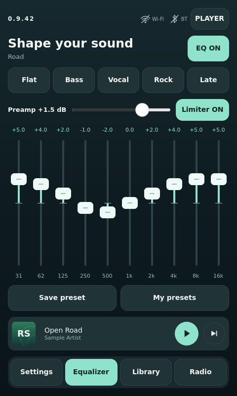
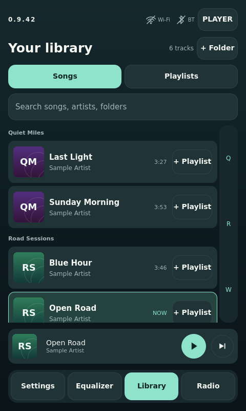

# Large Controls Player downloads

Signed Debian installers for the Raspberry Pi OS touchscreen music player.

- [Download the latest installer](https://github.com/chrisdamonpoe-byte/Large-Controls-Player-Releases/releases/latest)
- Install version **0.9.42** once with Raspberry Pi OS's Default Package Installer, then reopen the player.
- Future releases appear automatically under **Settings > App updates**. No GitHub account or token is needed on the Pi.
- For a manual transfer, copy the .deb and matching .deb.sig into Downloads and choose **Install from Downloads** in the player.

## Screenshots

Captured in Large Controls Player 0.9.42 with sample music.

| Now Playing | Equalizer |
| --- | --- |
|  |  |

| Music Library | App updates |
| --- | --- |
|  |  |
