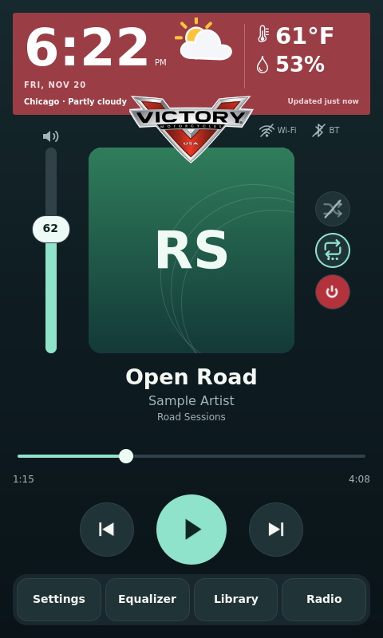
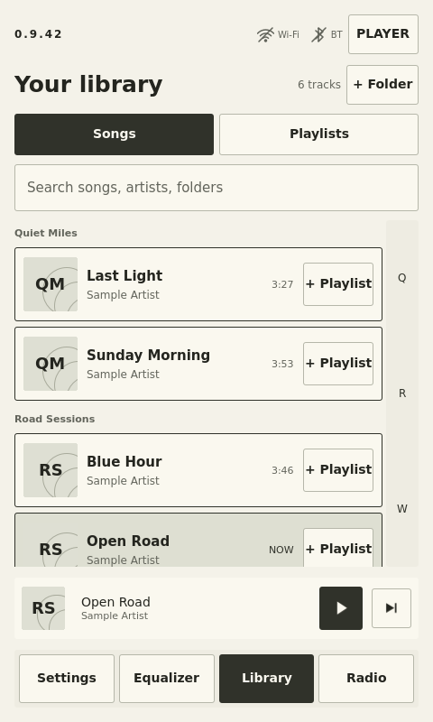

# Large Controls Player

Large Controls Player is a music and live radio player for Raspberry Pi OS. Its large touch controls and portrait layout are designed for small screens. This repository provides the signed Debian installers and screenshots.

- [Download the latest installer](https://github.com/chrisdamonpoe-byte/Large-Controls-Player-Releases/releases/latest)
- Install the latest version once with Raspberry Pi OS's Default Package Installer, then reopen the player.
- Future releases appear automatically under **Settings > App updates**. No GitHub account or token is needed on the Pi.
- For a manual transfer, copy the .deb and matching .deb.sig into Downloads and choose **Install from Downloads** in the player.

## Features

- **Now Playing** has large playback, volume and seek controls, shuffle and repeat, album artwork, and an optional live spectrum. After a close or reboot, the last track and position return paused.
- **Live Radio** is built in, with station logos, search, genre filters, and favorites. Gold stars mark favorites, Previous and Next cycle through them first, and **Media** returns to the music screen.
- **Music library** combines local, USB, and shared folders. Search the library, rescan for new music, safely eject a configured USB drive, and optionally download missing album covers.
- **Playlists** can be created, renamed, reordered, and deleted. Import M3U, M3U8, or PLS files, or use **+ Playlist** beside a song to add it to an existing playlist.
- **Equalizer** provides ten bands, built-in and named presets, a Preamp from -12 to +6 dB, and a Limiter switch. Named presets save the EQ bands and Preamp gain.
- **Display and touch** include Dark and E-Paper themes, screen rotation, three on-screen keyboard sizes, and a customizable clock color. Use the original Victory logo, choose a 282 x 154 pixel PNG, or hide the logo. Double-tap **PLAYER** to hold a tab and tap again to resume the auto-return timer.
- **Clock and weather** show the date, time, local conditions, and humidity. Tap the temperature to refresh. Colored indicators show Wi-Fi and Bluetooth connections.
- **Android Auto** can launch through LIVI with wired and wireless options. Local music pauses while Android Auto is active.
- **Raspberry Pi controls** include Wi-Fi and Bluetooth management, optional Start at login, Close app, Shutdown, and Reboot.
- **Updates** include Raspberry Pi OS package updates and signed app updates. Pulsing red dots signal available updates. App updates can be downloaded from GitHub or installed from Downloads.

## Screenshots

Captured in Large Controls Player 0.9.42 with sample music.

| Now Playing | Equalizer |
| --- | --- |
|  |  |

| Music Library | App updates |
| --- | --- |
|  |  |

### E-Paper theme

| Now Playing | Equalizer | Music Library |
| --- | --- | --- |
|  |  |  |

### Live Radio

Browse stations by genre, search by name, and tap the star to save a favorite. Starred station cards show a gold badge, and the large Previous and Next buttons cycle through those stations first. The large Play button controls radio, and **Media** returns to local music.

| Dark | E-Paper |
| --- | --- |
|  |  |
